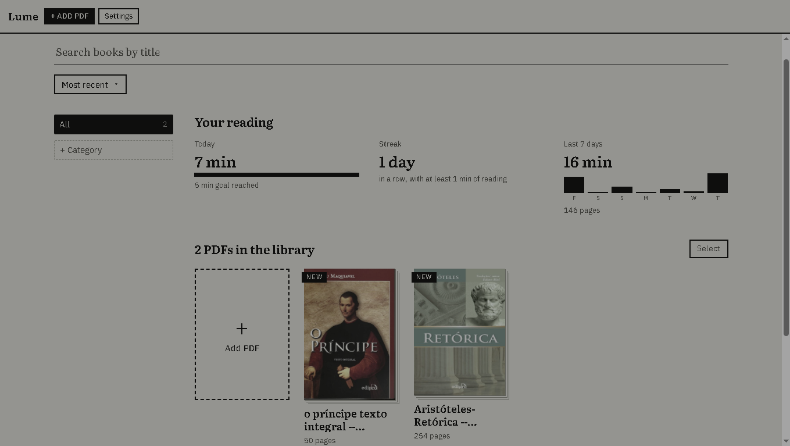

<div align="center">

# 📖 Lume

### Leitor de PDF com visual de papel, sépia, e-ink e noite

Leve, offline e feito para ler de verdade: biblioteca com capas, marcações, notas,\
estatísticas de leitura e telas que imitam papel e Kindle.

[](https://github.com/Lukelme/lume/releases/latest)
[](https://github.com/SEU-Lukelme/lume/releases)


<!-- Troque pelo print real do app: coloque a imagem em docs/ e ajuste o nome abaixo -->


</div>

---

## ⬇️ Baixar

<div align="center">

|  **Instalador (Setup)** |  **Versão portátil** |
|:---:|:---:|
| [**⬇ Baixar Lume-Setup.exe**](https://github.com/lukelme/lume/releases/download/v1.0.0/Lume-Setup.1.0.0.exe) | [**⬇ Baixar Lume-Portatil.exe**](https://github.com/Lukelme/Lume/releases/download/v1.0.0/Lume-portatil-1.0.0.exe) |
| Instala no computador, cria atalhos e pode abrir junto com o Windows. | Não precisa instalar: é só abrir o arquivo. Ótimo para pendrive. |

</div>

> Todas as versões estão na página de [**Releases**](https://github.com/lukelme/lume/releases).

**Qual escolher?**

- Use o **Setup** se você vai usar o Lume sempre: ele cria o atalho, associa os PDFs ("Abrir com…") e fica na bandeja do sistema para abrir na hora.
- Use o **Portátil** se quer só testar, ou levar o app em um pendrive sem instalar nada.

> [!NOTE]
> **Aviso do Windows ao abrir pela primeira vez.** O Lume ainda não tem assinatura digital paga, então o SmartScreen pode mostrar *"O Windows protegeu o computador"*. Clique em **Mais informações → Executar assim mesmo**. O código-fonte está todo aqui no repositório, e você pode conferir ou gerar o app você mesmo (veja [Para desenvolvedores](#-para-desenvolvedores)).

---

## Recursos

### Biblioteca
- Capas das páginas iniciais, barra de progresso e a seção **Continuar lendo**
- **Categorias** com lista lateral, prateleiras agrupadas e seleção de vários livros de uma vez
- Busca pelo nome, ordenação por recentes, título ou progresso
- Adicione PDFs pelo botão ou **arrastando os arquivos** para a janela
- **Backup e restauração** da biblioteca inteira (PDFs, progresso, marcações e metas) em um único arquivo `.lume`

### Telas para cada momento
| Tela | Para quê |
|---|---|
| **Papel** | Fundo e página na mesma cor, como uma folha de verdade |
| **Sépia** | Tom quente e confortável para leituras longas |
| **E-ink** | Tons de cinza (2 a 16), pontilhado nas imagens, cores suaves opcionais e atualização completa da tela como num leitor de tinta |
| **Noite** | Fundo escuro para ler no escuro |

Ajuste também o **brilho**, a **luz quente** e o quanto o **texto fica mais escuro**.

### Leitura
- **Uma página**, **duas páginas** (com opção de capa sozinha) ou **rolagem contínua**
- Ajuste por coluna, largura ou página inteira; **zoom de 50% a 400%**
- **Cortar margens** do PDF automaticamente
- **Rolagem automática** com velocidade ajustável
- **Régua de leitura** (modo foco): escurece tudo, menos a faixa em que você está lendo
- **Sumário** do PDF, campo para ir direto a uma página e **busca no texto** (`Ctrl + F`)

### Marcações e anotações
- Marcador de texto em **4 cores**, com seleção precisa
- **Notas** nas marcações e **páginas favoritas**
- **Exportar** trechos, notas e favoritos em Markdown (`.md`)
- Pesquise ou traduza o trecho selecionado no **Google, Google Acadêmico, Wikipédia, Google Tradutor ou DeepL**

### Hábito de leitura
- Tempo lido por dia, **meta diária**, **sequência de dias** e gráfico dos últimos 7 dias

### Idiomas
Português, English e Español, com tela de escolha no primeiro uso.

---

##  Atalhos

| Tecla | O que faz |
|---|---|
| `←` `→` | Página anterior e próxima |
| `Espaço` / `Shift + Espaço` | Rola uma tela para baixo / para cima |
| `Home` `End` | Primeira e última página |
| `Ctrl + G` | Ir para uma página |
| `Ctrl + F` | Buscar no PDF |
| `Ctrl + +` `Ctrl + −` `Ctrl + 0` | Zoom |
| `M` | Troca a tela (papel, sépia, e-ink, noite) |
| `H` | Esconde ou mostra os controles |
| `F11` | Tela cheia |
| `A` | Liga e pausa a rolagem automática |
| `R` | Liga e desliga a régua de leitura |
| `B` | Favorita a página |
| `1` `2` `3` `4` | Marca o texto selecionado (amarelo, verde, azul, rosa) |
| `?` ou `F1` | Mostra todos os atalhos |

---

## Privacidade

- Seus PDFs e anotações ficam **guardados só no seu computador**, dentro dos dados do app.
- **Sem conta, sem nuvem e sem envio de arquivos.** O Lume funciona 100% offline.
- A única vez que algo sai do app é quando **você** escolhe pesquisar ou traduzir um trecho: aí o navegador abre o site escolhido.

---

## Para desenvolvedores

O Lume é feito com **Electron**, HTML, CSS e JavaScript puro, e usa o **PDF.js** para ler os PDFs.

```bash
# instalar as dependências
npm install

# rodar em modo de desenvolvimento
npm start

# gerar o instalador e a versão portátil (os arquivos saem na pasta dist/)
npm run dist
```

```
lume/
├── main.js        # processo principal do Electron (janela, bandeja, início com o Windows)
├── preload.js     # ponte segura entre o app e o Electron
├── index.html     # estrutura da tela
├── style.css      # visual (papel, sépia, e-ink, noite)
├── script.js      # leitor, biblioteca, marcações, estatísticas
├── i18n.js        # traduções (EN e ES)
├── lib/           # PDF.js
├── fonts/         # Literata e IBM Plex Sans
└── build/         # ícones
```

---

## Licença

Distribuído sob a licença **MIT**. Veja o arquivo [`LICENSE`](LICENSE).

---

<div align="center">

Feito com carinho para quem gosta de ler. ⭐ Se o Lume te ajudou, deixe uma estrela no repositório!

</div>

<details>
<summary><b>🇬🇧 English summary</b></summary>

**Lume** is a lightweight, offline PDF reader for Windows with paper, sepia, e-ink and night screens. It has a cover-based library with categories, 4-color highlights, notes, bookmarks, Markdown export, reading stats with daily goals, in-PDF search, single/dual page and continuous scroll modes, a reading ruler, and full library backup. The interface is available in Portuguese, English and Spanish.

**Download:** get `Lume-Setup 1.0.0.exe` (installer) or `Lume-Portatil-1.0.0.exe` (portable, no install) from the [latest release](https://github.com/lukelme/lume/releases/latest).

Your files never leave your computer.

</details>